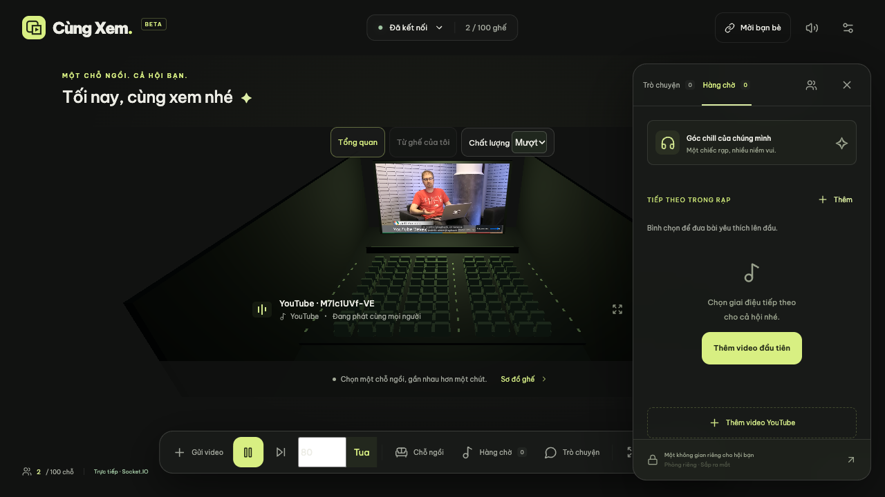
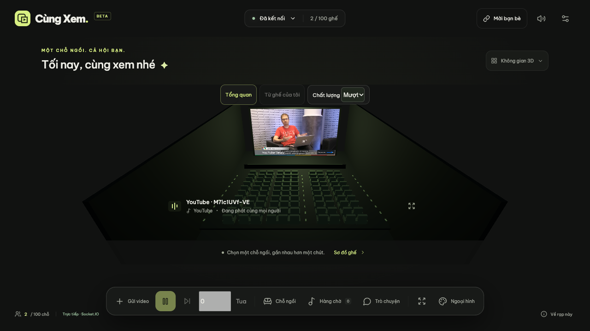

# Kiểm thử đồng bộ YouTube — 01/11/2026

Hai Chrome headless, hai browser context độc lập, YouTube thật và backend production cục bộ. Build và backend tests pass.

| Kịch bản | Revision | Lệch tương đối ước lượng | Lệch server lớn nhất |
|---|---|---:|---:|
| late join | 1 / 1 | 0.858 s | 0.994 s |
| pause | 2 / 2 | 0.873 s | 0.991 s |
| seek | 3 / 3 | 0.000 s | 0.000 s |
| play | 4 / 4 | 0.021 s | 0.091 s |
| change video | 5 / 5 | 0.038 s | 1.070 s |
| reconnect | 6 / 6 | 0.168 s | 0.598 s |

Các assertion videoId/revision giống nhau, player sẵn sàng, không có lỗi và lệch server tại mẫu ≤1,75 s đều pass. Khách bị khóa điều khiển. Reconnect: khách offline, chủ rạp tua tới 80 giây, khách online và nhận revision 6.

Phương pháp: residual = getCurrentTime − target được lấy trong cùng lần kiểm tra ở mỗi client. Chênh residual ước lượng độ lệch tương đối trên cùng timeline server. Mẫu cập nhật mỗi giây, không đồng thời tuyệt đối; đây là quan sát tại các điểm kiểm tra, không phải độ lệch cực đại hay phép đo đồng bộ âm thanh theo frame.

Backend tests dùng hai Socket.IO client thật: snapshot, clock, đổi video, tua, pause, reconnect, quyền giả mạo, revision cũ, giới hạn 250 ms và vị trí không hợp lệ. Parser kiểm tra URL hợp lệ và đầu vào giả mạo.

Giới hạn: ngưỡng sửa 1,25 s giữ sai lệch nhỏ để tránh giật; buffering, keyframe, mạng, CPU và tab nền có thể gây lệch tạm thời lớn hơn. Autoplay bị chặn và video private/đã xóa/không cho nhúng đã có UI xử lý; lần kiểm thử thật này không gặp các lỗi đó, chưa xác minh mọi mã lỗi bằng video thật. Chưa kiểm thử live/DVR, mobile, WAN hoặc chạy dài hạn.

State nằm trong RAM và mất khi restart. Quyền chủ rạp theo thứ tự kết nối, có thể đổi khi reconnect. Chưa triển khai hosting.

